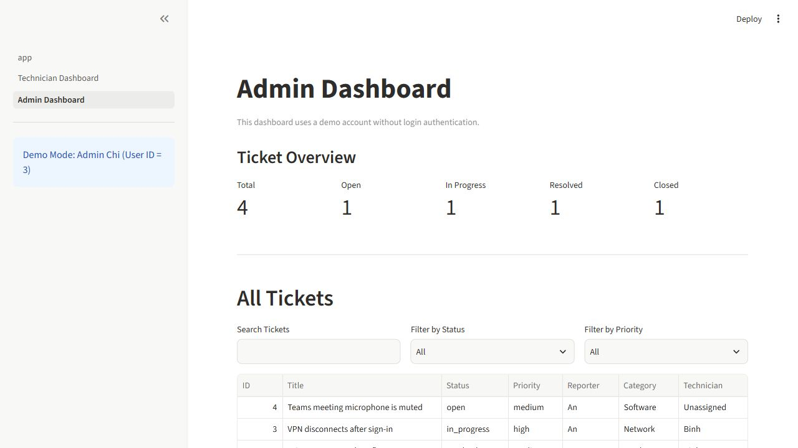
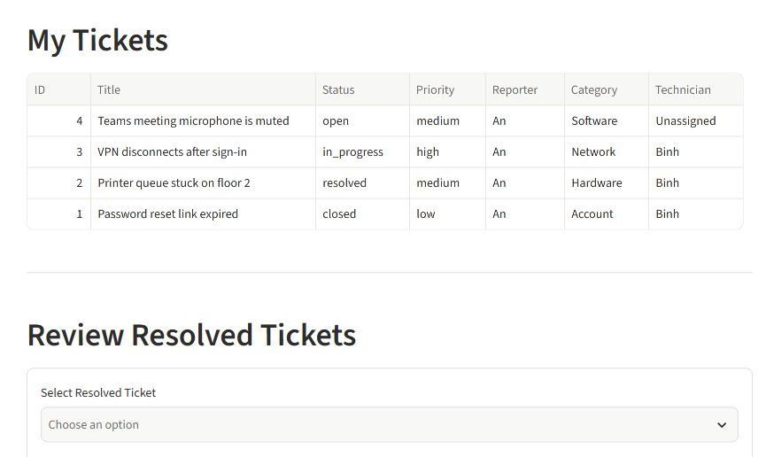
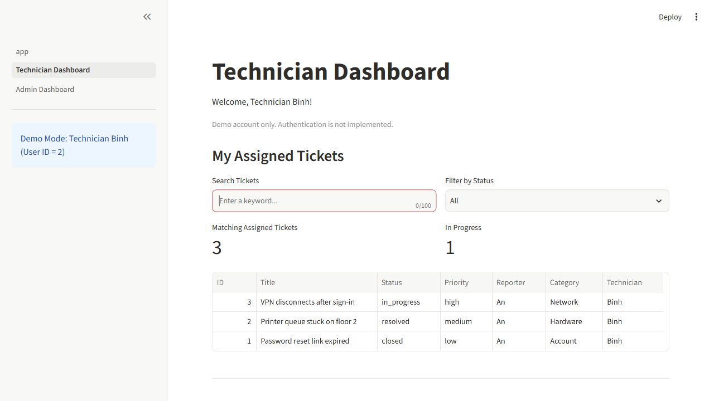

# IT Helpdesk & Asset Management System

A portfolio project that simulates IT support for a small company. The current application manages support tickets from submission through assignment, troubleshooting, and closure. It uses Python for business rules, SQLite for storage, and Streamlit for the interface.

## Run locally on Windows

Use Python 3.11 or later. Run the following commands from the repository folder in PowerShell.

```powershell
py -m venv .venv
.\.venv\Scripts\python.exe -m pip install -r requirements.txt
$env:HELPDESK_AUTH_MODE = 'demo'
.\.venv\Scripts\python.exe -m database.init_db
.\.venv\Scripts\python.exe -m streamlit run app.py
```

Open the local URL printed by Streamlit. The setup script creates `database/helpdesk.db` with demo users and ticket categories on a new installation. Run it again after updating the code to apply schema migrations to an existing database. Create a ticket from the dashboard to start the demo. Git ignores the local database file.

## Run an internal pilot

Use a dedicated database and the default company sign-in mode. The [operations guide](docs/operations.md) covers secret configuration, OIDC account enrollment, deployment, schema updates, and backup and restore. The demo environment setting only works with a database marked for demo use.

## Try the ticket workflow

The pages use fixed demo identities. Use the Streamlit sidebar to navigate between dashboards.

| Step | Dashboard | Action | Result |
| --- | --- | --- | --- |
| 1 | Employee (An) | Create a ticket for a Wi-Fi issue. | Status is `open`. |
| 2 | Admin (Chi) | Assign the ticket to Binh. | Status is `in_progress`. |
| 3 | Technician (Binh) | Add troubleshooting notes and select **Mark as Resolved**. | Status is `resolved`. |
| 4 | Employee (An) | Select **Reopen Ticket** and describe the remaining issue. | Status returns to `in_progress`. Binh keeps the assignment. |
| 5 | Technician (Binh) | Fix the remaining issue and mark the ticket resolved again. | Status is `resolved`. |
| 6 | Employee (An) | Select **Close Ticket** and confirm the fix. | Status is `closed`. |

The Admin dashboard also displays totals by status, search and filters, and reassignment of in-progress tickets with a reason. The Technician queue lists assigned tickets by priority, oldest first within each priority. Lists and action pickers are paginated. Enter the ticket ID under **Ticket details and shared history** to view the original description and notes you have access to. See the [ticket workflow](docs/ticket_workflow.md) for the full process.

## How the system works

1. The [Employee Dashboard](app.py), [Technician Dashboard](pages/1_Technician_Dashboard.py), and [Admin Dashboard](pages/2_Admin_Dashboard.py) collect input and display the latest ticket data.
2. The [authentication guard](src/auth.py) resolves a signed-in company account to a local user and checks the page's role. The [ticket service](src/ticket_service.py) applies ticket ownership rules, validates updates, and checks the version shown in the submitting form.
3. SQLite stores the current record in `TICKETS` and logs the actor, status, and note in `TICKET_HISTORY`. A transaction commits the ticket update and its history entry together. A stale form cannot save after another session has changed the record.

The [database design](docs/erd.md) describes the relationships between `USERS`, `CATEGORIES`, `TICKETS`, and `TICKET_HISTORY`. See the [requirements](docs/requirement.md) for the project scope.

## Dashboard screenshots

These screenshots use a temporary database populated with fictional support requests.

### Admin overview



### Employee tickets



### Technician queue



## Run the tests

Run the following command after installing the dependencies.

```powershell
.\.venv\Scripts\python.exe -m unittest discover -s tests -v
```

The tests initialize temporary SQLite databases, so you can run them before creating the app's database. They cover input validation, role and ownership checks, transaction rollback, and stale forms. The [workflow test](tests/test_ticket_workflow.py) uses Streamlit `AppTest` to simulate the six steps above across three dashboards and check all six history entries in order.

The tests cover the demo workflow, role and identity checks with simulated OIDC claims, stale updates after reopening, reassignment and history, pagination, data migrations, and backup. Use the [manual test cases](docs/ticket_workflow.md#6-manual-test-cases) to exercise the browser and inspect SQLite. Validate the real sign-in flow against your organization's identity provider during pilot setup.

## Code map by week

| Milestone | Where to read | What to follow |
| --- | --- | --- |
| Week 1 — SQLite design | [Schema and SQL exercises](database/TICKET_MANAGEMENT.sql), [ERD](docs/erd.md), [Git ignore rules](.gitignore) | Tables, foreign keys, sample data, and the first ticket lifecycle in SQL. |
| Week 2 — Python service | [Connection](src/db.py), [database initializer](database/init_db.py), [ticket service](src/ticket_service.py), [service tests](tests/test_ticket_service.py) | Initialize the Week 1 schema from Python, validate inputs, scope queries by role, and write tickets and history together. |
| Week 3 — Dashboards | [Streamlit dependency](requirements.txt), [Employee, lessons 3.2 and 3.5](app.py), [Technician, lesson 3.3](pages/1_Technician_Dashboard.py), [Admin, lesson 3.4](pages/2_Admin_Dashboard.py), [Employee tests](tests/test_employee_dashboard.py), [Technician tests](tests/test_technician_dashboard.py) | How Streamlit forms call the service to create, assign, resolve, reopen, and close tickets. |
| Week 4 — Testing and polish | [Workflow test](tests/test_ticket_workflow.py), [Employee form tests](tests/test_employee_dashboard.py), [Technician filter tests](tests/test_technician_dashboard.py), [manual test cases](docs/ticket_workflow.md#6-manual-test-cases) | How isolated test data, browser checks, and form reset verification cover the complete workflow. |
| After Week 4 — Sign-in and ticket handling | [Authentication](src/auth.py), [user management](database/manage_users.py), [ticket service](src/ticket_service.py), [shared UI](src/dashboard_ui.py), [authentication tests](tests/test_auth.py), [ticket service tests](tests/test_company_tickets.py) | Company sign-in, version checks, ticket details, handoff, and pagination. |
| After Week 4 — Database operations and CI | [Initializer](database/init_db.py), [migrations](database/migrations.py), [backup](database/backup_db.py), [database tests](tests/test_database.py), [GitHub Actions](.github/workflows/tests.yml), [operations guide](docs/operations.md) | Upgrade existing databases, verify backups, and run the test suite on GitHub. |

Search for `Tuần 1` through `Tuần 4` or `Sau Tuần 4` to find the Vietnamese comments in source files, tests, and configuration. Files used across multiple milestones mark the added blocks near the relevant code.

## Project progress

- [x] Week 1 — Requirements, database design, and SQLite schema.
- [x] Week 2 — Python ticket service, role checks, and transaction tests.
- [x] Week 3 — Streamlit dashboards, assignment, resolution, and close or reopen.
- [x] Week 4 — Automated workflow testing and local setup documentation.
- [x] Week 4 — Browser usability checks, screenshots, and manual test cases.
- [x] Internal pilot foundation — Company sign-in, version checks, ticket detail and reassignment, pagination, and database operations.

Asset management and Power BI analytics are planned for future phases.
